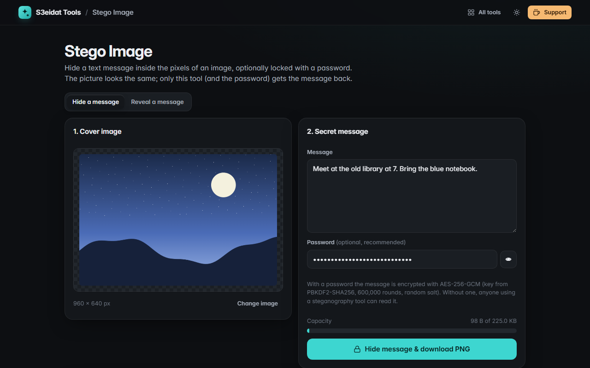

# Stego Image

> Hide a secret message inside an image. Free, private, and it runs entirely in your browser.

### ▶ [Open Stego Image](https://s3eidat.github.io/stego-image/)



## Features

- **Hide** a text message (any language, emoji included) in the pixels of any image; the result is a PNG that looks the same
- **Optional password:** the message is encrypted with **AES-256-GCM**; the key comes from **PBKDF2-SHA256 with 600,000 rounds**
  and a random 16-byte salt, with a random 12-byte IV for every message. A wrong password or any change to the data is detected
- **Capacity meter** shows how much of the image you are using
- **Self-check:** before downloading, the tool reads its own PNG back and confirms the message survives
- **Reveal** tab reads the message back, and asks for the password when it's encrypted
- Clear messages when there is nothing to find, when a JPEG was used, or when the password is wrong

## How it works

Each pixel has red, green and blue values from 0 to 255. The tool replaces the lowest bit of each value with one bit
of your message, which changes the colour by at most 1/255, invisible to the eye. A small header (`S3SG`, version,
flags, length) comes first so the reveal side knows what to read. Transparent areas are filled with white first,
because browsers can't store exact values in see-through pixels.

## Limits (please read)

- **JPEG destroys it.** Saving as JPEG, resizing, cropping, editing or sending through apps that recompress photos
  (WhatsApp, Instagram, Facebook, X…) erases the message. Send the PNG **as a file** (email attachment, cloud drive,
  "send as document").
- **Hidden is not undetectable.** Least-significant-bit steganography can be spotted by forensic tools. Use a password
  so that, even if the data is found, it can't be read.
- Some privacy-focused browsers add noise to images read by web pages; the self-check catches this and won't give you a broken file.

## Privacy

Your image, message and password never leave your device. Encryption uses the browser's built-in Web Crypto API.
There is no server, no account, no analytics. The page ships with a strict Content-Security-Policy
(`connect-src 'self'`), so the browser itself blocks any attempt to send data anywhere.

## Run it yourself

It's plain HTML, CSS and JavaScript with no build step:

```bash
git clone https://github.com/s3eidat/stego-image
cd stego-image
python -m http.server 8000
```

Then open http://localhost:8000 (passwords need `localhost` or https, because Web Crypto only runs in secure contexts).

## Support

If this saved you time, **[buy me a coffee ☕](https://s3eidat.github.io/coffee/)**. It keeps every tool free.

---

Part of **[S3eidat Tools](https://s3eidat.github.io/)**: 100+ free, private tools that run in your browser. MIT licensed.
